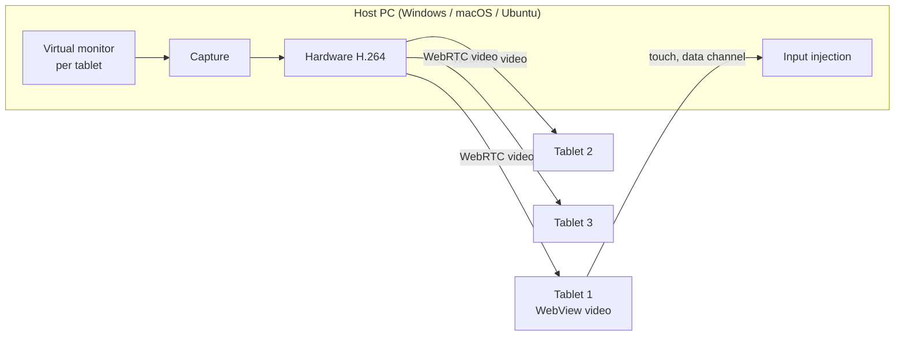
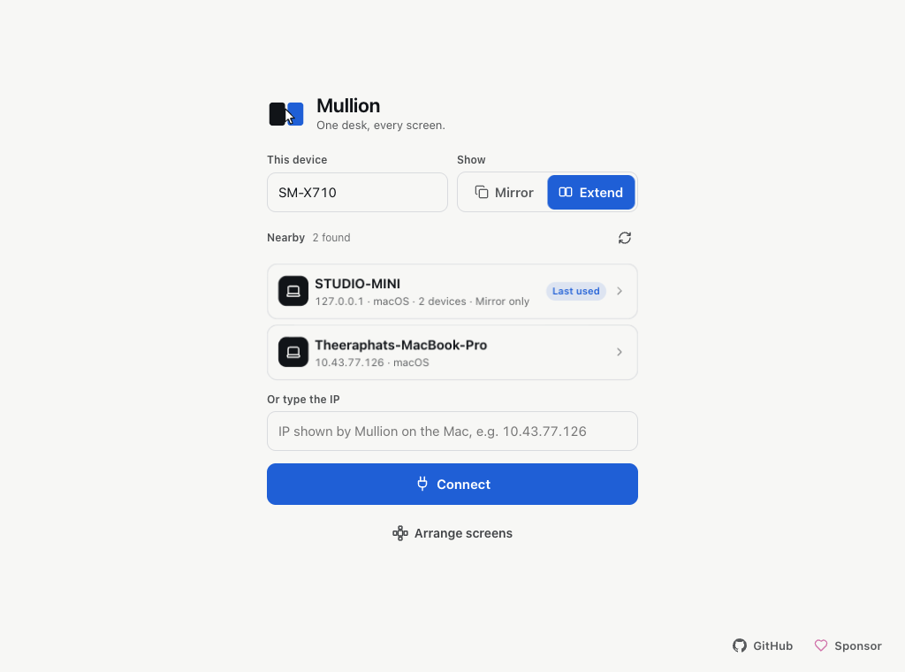
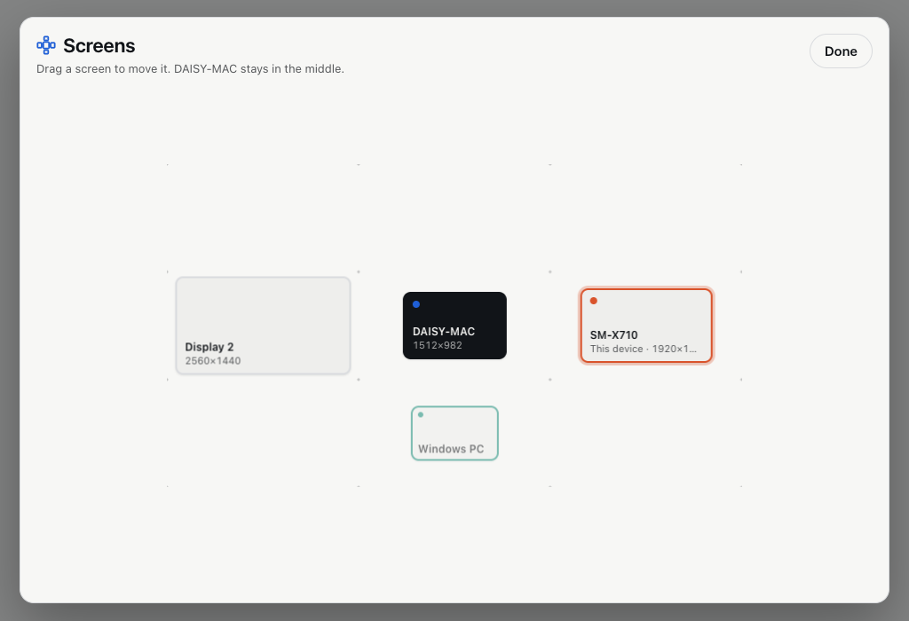

<p align="center"></p>

<p align="center"><b>One desk, every screen.</b></p>

Mullion turns up to three Android tablets into extra monitors for a Windows, Mac or
Ubuntu PC over your local network, and moves one mouse and keyboard across all of
them. Written in Rust with [Dioxus](https://dioxuslabs.com).

**Status: planning.** No code yet. Start with [docs/PLAN.md](docs/PLAN.md).

## Three modes per device

| Mode | The device shows | Network |
| --- | --- | --- |
| Extend | Its own part of the desktop, on a virtual monitor | 8 to 15 Mbps |
| Mirror | A copy of the main screen; one encode shared by every mirroring device | 8 to 15 Mbps total |
| Control | Its own screen, driven by another device's mouse and keyboard across a screen edge | Input events only |

Switching mode never needs pairing again.

## How it works



Only four parts differ by OS (virtual monitor, capture, encode, input), and they sit
behind one Rust trait. Pairing, transport, the UI and the Android app are shared.

| Part | Windows | macOS | Ubuntu |
| --- | --- | --- | --- |
| Virtual monitor | IddCx driver (MttVDD) | CGVirtualDisplay | Portal virtual monitor, evdi on X11 |
| Capture | Windows Graphics Capture | ScreenCaptureKit | PipeWire via portal |
| Encode | NVENC, Quick Sync, AMF | VideoToolbox | VA-API, NVENC |
| Input | SendInput | CGEvent | RemoteDesktop portal, uinput |

## Docs

| File | What it holds |
| --- | --- |
| [docs/PLAN.md](docs/PLAN.md) | Ten build steps, gates, repo layout, risks, open decisions |
| [docs/SRS.md](docs/SRS.md) | Spec for PoC 1: mirror one screen to one tablet under 50 ms |
| [docs/TEST_PLAN.md](docs/TEST_PLAN.md) | 29 tests covering every requirement in the SRS |
| [brand/BRAND.md](brand/BRAND.md) | Name, mark, color, type, motion, cursor label, voice |

## Install on a Mac

```sh
tools/package-macos.sh            # -> dist/Mullion-0.1.0.pkg and dist/macos/Mullion.app
open dist/Mullion-0.1.0.pkg       # installs to /Applications and opens Mullion
```

Mullion runs in the menu bar (no Dock icon). Its menu shows the address
tablets connect to, the devices connected, **Arrange Screens…**, **Allow Screen
Recording…** while that permission is missing, **Show Logs**, and **Quit**. The
first launch says where to find it. Logs are in `~/Library/Logs/Mullion`;
settings go in `~/Library/Application Support/Mullion/mullion.env` (same
`MULLION_*` keys as `.env`). Quit a terminal host first: both use ports 47100 and 80.

The package is ad-hoc signed and for Apple silicon. With an ad-hoc signature
macOS asks for Screen Recording again after each rebuild; set
`MULLION_SIGN_ID` to a signing identity to keep it. A package for other Macs
needs a Developer ID (`MULLION_SIGN_ID`, `MULLION_INSTALLER_ID`) and notarization.

## Running the host (macOS)

```sh
tools/run-host.sh                 # builds and runs; Terminal needs Screen Recording
tools/run-host.sh --show-config   # effective switches
cp .env.example .env              # then edit: MULLION_EXTEND=false, MULLION_DISPLAY_GRACE_SECS=0, ...
```

Open `http://<mac-ip>` on a tablet (**Copy Address** in the menu gives exactly
that). The host serves the receiver on port 80 as well as 47100, so the bare
address works in any browser; if port 80 is taken it says so in the log and the
address it shows and copies becomes `<mac-ip>:47100`. `MULLION_WEB_PORT=0`
turns port 80 off. `/devices` lists who is connected and which screen they
own; `/config` shows the live switches.

## Finding the Mac

The setup card lists Mullion hosts on the network under **Nearby**; tap one to
connect. Entering the address still works: what Copy Address puts on the
clipboard, a pasted `http://10.0.0.5/`, or a port when it is not 47100
(`10.0.0.5:47199`). The receiver asks `GET /hello` on, in order: the host that
served the page, hosts used before, every address of their /24 networks and of
this device's own, then common home ranges if it knows nothing else. Browsers
cannot do mDNS or broadcast, hence the sweep; a /24 takes about 5 s, known
hosts show up at once.



## Arranging screens

**Screens** (toolbar while streaming, or **Arrange screens** on the setup card)
opens the layout map: every display of the Mac on a grid, the Mac's main display
fixed in the middle. Drag a screen to any outlined spot that touches another
screen edge-on; drop it on another screen to swap the two. Arrow keys move a
focused screen one cell. The Mac rearranges its displays to match right away,
and a device that reconnects goes back where it was put (until the host exits).



`GET /screens` returns the grid; `POST /screens/layout` with
`{"cells":[{"display_id":7,"col":-1,"row":0}]}` moves screens (409 with the
reason if the layout cannot be placed). The geometry lives in
[`crates/proto/src/layout.rs`](crates/proto/src/layout.rs).

## Targets

1080p at 60 fps per tablet, under 50 ms latency on 5 GHz Wi-Fi. For three tablets at
once, put the PC on Ethernet and the tablets on 5 GHz.
