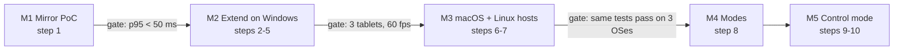
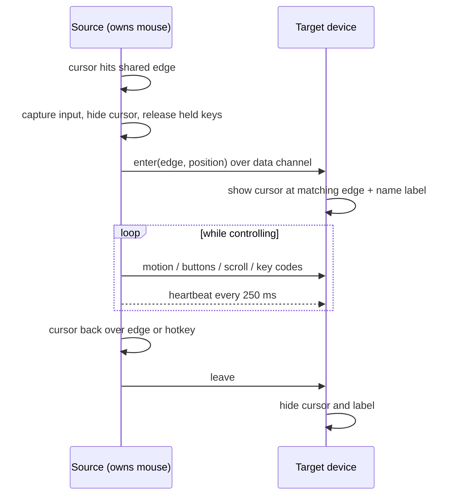

# Mullion implementation plan

Ten build steps in five milestones, each closed by a gate that can be checked.
Nothing is built yet. Step 1 is specified in full in [SRS.md](SRS.md) and
[TEST_PLAN.md](TEST_PLAN.md); later steps get their own SRS when they start.
Step 1 is being built; the decisions below (1 to 4) were taken on 2026-11-09.



## Repo layout (planned)

Three crates, not one per OS. OS code lives in `cfg`-gated modules inside `host`.

```
mullion/
  Cargo.toml              workspace
  crates/
    proto/                wire messages, pairing, layout map, edge math. No OS calls, all unit-tested.
    host/                 trait Platform + windows.rs, macos.rs, linux.rs; capture, encode, inject, overlay
    app/                  Dioxus UI: desktop build is the host app, Android build is the tablet app
  android/                Kotlin only where Rust can't reach: AccessibilityService, IME
  brand/                  logo, mark, BRAND.md
  docs/                   PLAN, SRS per step, TEST_PLAN per step
```

## The platform trait

The four parts that differ by OS, from the plan, behind one trait. Sketch only:

```rust
pub trait Platform {
    fn create_monitor(&self, w: u32, h: u32, hz: u32) -> Result<MonitorId>; // step 2
    fn capture(&self, m: MonitorId) -> Result<FrameStream>;                 // GPU textures
    fn encoder(&self, w: u32, h: u32, kbps: u32) -> Result<Box<dyn Encoder>>; // hardware H.264
    fn inject(&self, ev: InputEvent) -> Result<()>;                         // touch, mouse, keys
}
```

Control mode adds two more (`capture_input`, `show_cursor_label`) in step 9, not before.

## One transport

WebRTC everywhere, including computer to computer in Control mode. The tablets
already need it for video, str0m does data channels, and one transport means one
pairing and one encryption story. The plan allowed QUIC as an option; it is
dropped unless step 9 measures data-channel input latency above 10 ms on the LAN.

## Build steps

| Step | Milestone | Build | Gate (all must pass) |
| --- | --- | --- | --- |
| 1 | M1 | Mirror the macOS main display to one tablet: ScreenCaptureKit, VideoToolbox, str0m, `<video>` in the Dioxus Android app | [SRS.md](SRS.md) section 7: p95 under 50 ms, 57+ fps |
| 2 | M2 | Virtual monitor per device. **Done on macOS first** (CGVirtualDisplay, 2026-11-09, `feat/3-extend-macos`); Windows via the IddCx driver (VirtualDrivers/MttVDD) still to do | The OS shows the tablet in Display Settings; dragging a window onto it shows it on the tablet; host exit leaves no ghost monitor. macOS: passed by hand on 2026-11-09 with two tablets |
| 3 | M2 | mDNS discovery (`_mullion._tcp`) and 6-digit PIN pairing (SPAKE2), then pinned certificate fingerprints | Unpaired device on the LAN cannot get a stream; wrong PIN 5 times locks pairing for 60 s; re-pair not needed after reboot |
| 4 | M2 | Three tablets, one virtual monitor and one encoder session each. Per-device displays and sessions landed with step 2 on macOS; the 3-tablet soak and the session-limit message remain | 3 x 1080p60 for 10 min, each p95 under 50 ms; a clear message when the GPU's encoder session limit is hit |
| 5 | M2 | Touch from tablet to PC over the data channel; then USB wired mode via `adb reverse` | Tap lands within 2 px of target; drag latency under 60 ms; USB mode p95 under 30 ms |
| 6 | M3 | macOS host: CGVirtualDisplay and CGEvent on top of the step 1 capture and encode | Steps 2, 4, 5 tests pass on macOS 14+; permission prompts use BRAND.md copy |
| 7 | M3 | Ubuntu host: portal virtual monitor + PipeWire on Wayland, evdi on X11, VA-API or NVENC, RemoteDesktop portal | Same tests pass on the current Ubuntu LTS (GNOME, Wayland); restore token saved so the prompt shows once |
| 8 | M4 | Mode switch per device: Extend, Mirror (one shared encode), Control | Switching mode never asks to pair again; 2 tablets mirroring cost one encode, checked in the GPU session count |
| 9 | M5 | Layout map and edge switching between computers, then Android as a target (AccessibilityService + overlay cursor + IME) | Cursor crosses an edge in under 30 ms; held keys released before every switch; Thai/English layout follows the target device |
| 10 | M5 | Cursor name labels, switch and lock hotkeys, return-on-disconnect | Label visible on Windows, macOS, X11, KDE Wayland, Android; GNOME shows the top-bar fallback; pulling the network cable returns input within 1 s |

## Design that carries across steps

- **Pairing.** The PIN is shown on the device that owns the screen and typed on the
  other. After pairing, each side stores the other's DTLS certificate fingerprint;
  later sessions refuse any other fingerprint. Signaling moves from plain HTTP
  (step 1) to the paired channel in step 3.
- **Layout map** (step 9) lives in `proto` as pure geometry: device rectangles in a
  shared coordinate space, shared edges computed from them, and the crossing point
  mapped proportionally along the edge. This is the part with the most edge cases
  (unequal heights, corners, DPI), so it gets the most unit tests.
- **Keyboard.** Send physical key codes (USB HID usage IDs), never characters.
  Modifier mapping Ctrl to Cmd is a per-pair toggle stored with the pairing.
- **Safety.** A 250 ms heartbeat on every controlled link; four missed beats return
  input locally. Ctrl+Alt+Esc always works because the source device never stops
  watching for it.
- **UI.** The host app has three views: Devices (list + layout map), Device (mode,
  name, color), Settings (hotkeys, permissions). Look and motion follow
  [BRAND.md](../brand/BRAND.md).

## Control mode, one crossing



## Risks

| Risk | Step | Impact | Plan |
| --- | --- | --- | --- |
| WebView adds too much receive latency | 1 | Redesign of the tablet app | PoC 1 measures it; fallback is MediaCodec via JNI |
| Dioxus Android build can't host a Kotlin AccessibilityService and IME | 9 | Control mode on Android blocked | Spike in step 5: add an empty service to the generated Gradle project; if the Dioxus CLI regenerates it, keep a separate Android shell around the Rust library |
| Windows driver signing | 2 | Users can't install | Use MttVDD's signed release first; own signing only if we fork it |
| CGVirtualDisplay is private API | 6 | No Mac App Store, may break on update | Ship outside the store, notarized; test each macOS beta |
| GNOME blocks floating overlays | 10 | No cursor label on GNOME Wayland | Top-bar indicator + notification, as the plan says |
| GPL code in lan-mouse and Input Leap | 9 | License contamination | Read for design only; no copied code unless Mullion's license is chosen to match |
| Google Play review of Accessibility use | 9 | Store rejection | In-app disclosure screen in BRAND.md voice; sideload build as backup |

## Decisions taken (2026-11-09)

1. Name Mullion and the v0 mark stay. A class 9/42 trademark search is still owed
   before anything ships; `mullion.app` and `mullion.dev` are already registered.
2. macOS hosts PoC 1 on the available M1 Mac; Windows is still the first host for
   M2 because Extend mode needs IddCx. See SRS A-2.
3. License `MIT OR Apache-2.0`. GPL prior art is read for design only.
4. Tracker: GitHub Issues on the `mullion` repo; PRs land on `dev`.
